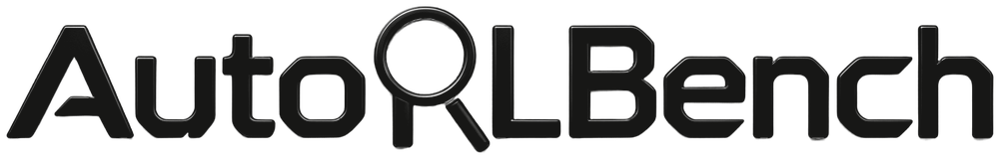
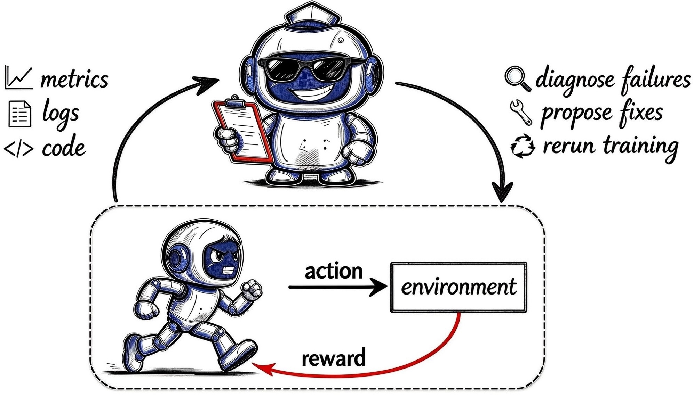
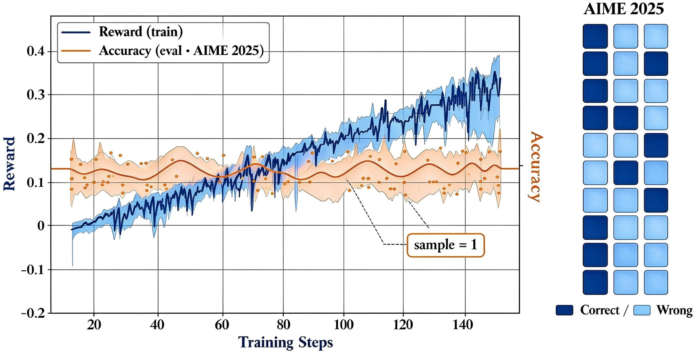
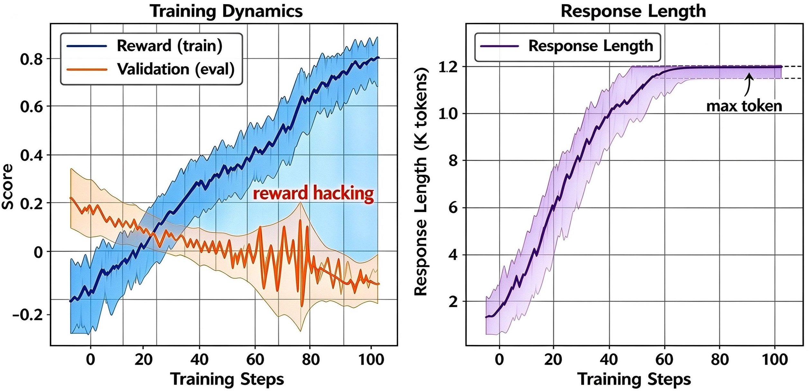
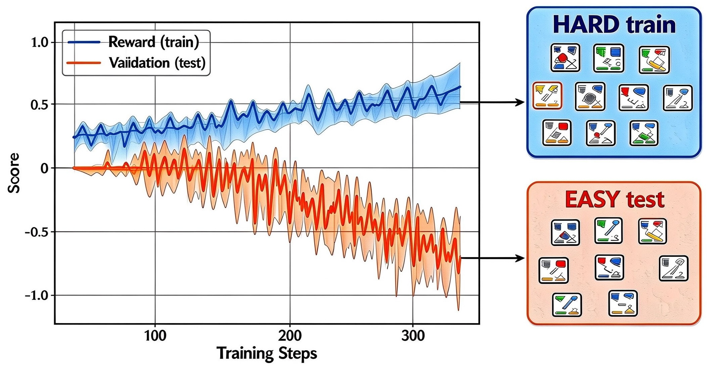
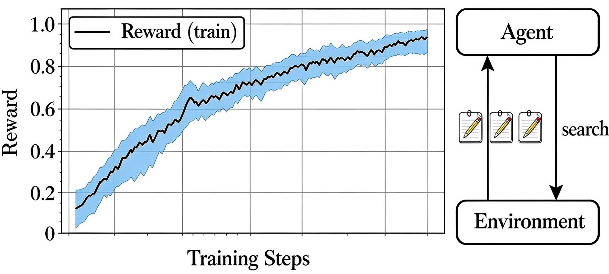
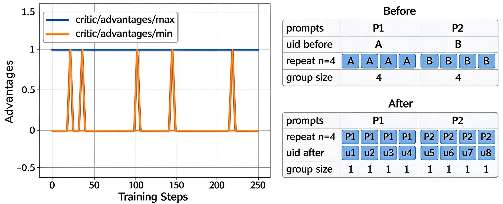
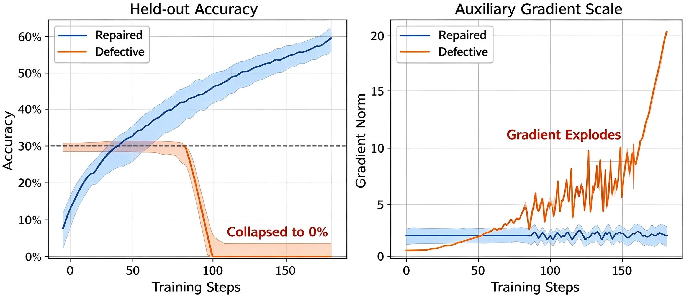

<p align="center">
  <a href="https://thinking-space.github.io/AutoRLBench/"></a>
</p>

<p align="center">
  <a href="https://thinking-space.github.io/AutoRLBench/"></a>
  <a href="https://thinking-space.github.io/AutoRLBench/#leaderboard"></a>
  <a href="https://thinking-space.github.io/AutoRLBench/#tasks"></a>
  <a href="https://thinking-space.github.io/AutoRLBench/contribute.html"></a>
  <a href="LICENSE"></a>
  <a href="README_zh.md"></a>
</p>

A benchmark and open call for valuable, reproducible RL runs. Each task is a real training run that went wrong. The agent has to find the root cause (**issue**) and, where a repaired run exists, fix it and rerun (**solution**).

<p align="center"></p>

## Leaderboard

AutoRLBench Leaderboard 0.1, issue evaluation. *First release; updated as new agents and tasks are added.*

| # | Model | Agent | Issue score | |
| ---: | --- | --- | ---: | :--- |
| 1 | Claude-Fable-5.1 | Claude Code | 0.86 | ██████████████████░░ |
| 2 | Grok-4.7 | Grok Build | 0.79 | ████████████████░░░░ |
| 3 | GPT-6-Astra | Codex | 0.64 | █████████████░░░░░░░ |
| 4 | GLM-5.3 | Claude Code | 0.64 | █████████████░░░░░░░ |
| 5 | GPT-6.1-Sol | Codex | 0.57 | ████████████░░░░░░░░ |
| 6 | Qwen3.8-Max | Qwen Code | 0.57 | ████████████░░░░░░░░ |
| 7 | Kimi-K3 | Claude Code | 0.50 | ██████████░░░░░░░░░░ |
| 8 | Gemini-4-Argon | Claude Code | 0.43 | █████████░░░░░░░░░░░ |
| 9 | DeepSeek-V4-Pro | Claude Code | 0.29 | ██████░░░░░░░░░░░░░░ |

Solution evaluation (repair and rerun) is coming soon. Full results: [website](https://thinking-space.github.io/AutoRLBench/#leaderboard).

## Tasks

Six domains, one representative task each. The domains come from where in the RL pipeline the failure lives:

<table>
<tr>
<td width="50%" valign="top">
<a href="tasks/configuration/verl_aime25_single_sample_protocol/">

</a>
<strong>Configuration</strong> · issue · solution<br>
<a href="tasks/configuration/verl_aime25_single_sample_protocol/"><b>AIME25 single-sample variance</b></a><br>
One sample per question makes a 30-question score too noisy to judge the run.
</td>
<td width="50%" valign="top">
<a href="tasks/reward/slime_retool_length_reward_bonus/">

</a>
<strong>Reward</strong> · issue · solution<br>
<a href="tasks/reward/slime_retool_length_reward_bonus/"><b>Length bonus reward hack</b></a><br>
An unconditional length bonus teaches the policy to write longer, not better.
</td>
</tr>
<tr>
<td width="50%" valign="top">
<a href="tasks/data/verl_taco_difficulty_mismatch/">

</a>
<strong>Data</strong> · issue<br>
<a href="tasks/data/verl_taco_difficulty_mismatch/"><b>Training data is too hard</b></a><br>
Train is TACO <code>VERY_HARD</code> while validation is <code>EASY</code>; held-out accuracy ends below its start.
</td>
<td width="50%" valign="top">
<a href="tasks/environment/search_r1_zero_query_embedding/">

</a>
<strong>Environment</strong> · issue · solution<br>
<a href="tasks/environment/search_r1_zero_query_embedding/"><b>Zero query vector in retrieval</b></a><br>
The retriever's query vector is all zeros, so every query gets the same documents.
</td>
</tr>
<tr>
<td width="50%" valign="top">
<a href="tasks/algorithm/verl_grpo_uid_after_repeat/">

</a>
<strong>Algorithm</strong> · issue<br>
<a href="tasks/algorithm/verl_grpo_uid_after_repeat/"><b>GRPO uid assigned after rollout repeat</b></a><br>
The uid assignment lands after the rollout repeat step, making every GRPO group a singleton and silently degrading training to baseline-free REINFORCE.
</td>
<td width="50%" valign="top">
<a href="tasks/infrastructure/verl_moe_token_normalization/">

</a>
<strong>Infrastructure</strong> · issue · solution<br>
<a href="tasks/infrastructure/verl_moe_token_normalization/"><b>MoE auxiliary gradients miss token normalization</b></a><br>
The per-token loss callback omits the token count, so MoE z-loss gradients are never normalized.
</td>
</tr>
</table>

## How a task works

```text
prepare ──▶ agent ──▶ [rerun] ──▶ verifier
  │           │          │            │
  │           │          │            └─ issue:    LLM judge on agent_answer.md vs. hidden oracle
  │           │          │               solution: a metric threshold on the rerun's logs
  │           │          └─ solution only: the harness re-runs the experiment on the agent's
  │           │             workspace, per the task's run_spec.json
  │           └─ reads instruction.md and a writable copy of workspace/
  └─ fetches pinned models and datasets (the only stage with network)
```

Each stage runs in its own container from the same prebuilt image. Oracles and verifiers are mounted only into the verifier stage.

At the solution level the agent repairs the workspace and submits `report.md` — it does **not** launch training itself. The harness clears the task's log roots, re-runs the experiment on the repaired workspace, and grades only that fresh run. No `report.md`, no rerun and no grading: the task scores 0. A solution task without a `run_spec.json` (a pure protocol repair, say) skips the rerun but is bound by the same report gate.

## Repository layout

| Path | Contents |
| --- | --- |
| [`tasks/`](tasks/) | Benchmark tasks, grouped by domain |
| [`autorlbench/`](autorlbench/) | Evaluation harness: task loader, validator, runtimes, agent adapters, CLI |
| [`docker/`](docker/) | Shared environment images and in-container tooling ([README](docker/README.md)) |
| [`skills/package-task/`](skills/package-task/) | Agent skill that turns a raw task into a task |
| [`tests/`](tests/) | Harness unit tests |
| [`page/`](page/) | Website source, deployed to GitHub Pages |

## Task layout

```text
tasks/<domain>/<task_id>/
├── README.md               # summary, difficulty, reference solution, verification
├── task.toml               # metadata and environment image
├── workspace/              # the run as the agent sees it: code, config, logs, metrics
├── environment/prepare.sh  # fetches pinned models and datasets (only stage with network)
└── evaluations/
    ├── issue/              # instruction.md · oracle.md · verifier/
    └── solution/           # instruction.md · oracle/ · verifier/ (grader_spec.json · run_spec.json)
```

## Quick start

```bash
# Validate a task
python3 -m autorlbench validate tasks/reward/slime_retool_length_reward_bonus

# Prepare and run the verifier on a task in Docker (no agent)
python3 -m autorlbench evaluate tasks/reward/slime_retool_length_reward_bonus \
  --evaluation-level issue --backend docker \
  --judge-model <judge-model> --json

# Run an agent through Harbor (pip install harbor)
python3 -m autorlbench harbor-evaluate tasks/reward --agent codex --model <model>
```

Run `python3 -m autorlbench --help` for every option. The issue verifier calls an OpenAI-compatible judge through `OPENAI_BASE_URL` and `OPENAI_API_KEY`. `evaluate` runs no agent, so at `--evaluation-level solution` it stops at the report gate and scores 0 unless the staged workspace already carries a `report.md`.

## Contributing

We welcome both problematic runs and healthy reference runs. Bring the issue materials, or add the repaired run when it exists; an agent does the packaging. Contribute **two valid tasks** and you become a co-author on the benchmark paper. See [CONTRIBUTING.md](CONTRIBUTING.md) and the [contribution guide](https://thinking-space.github.io/AutoRLBench/contribute.html).

## License

Apache-2.0. Each task's workspace keeps the license of its upstream code.
