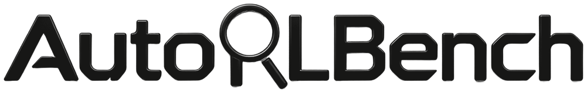
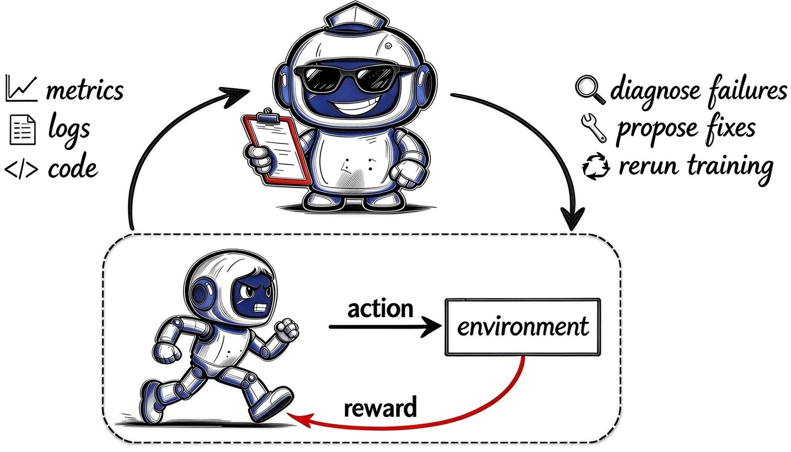
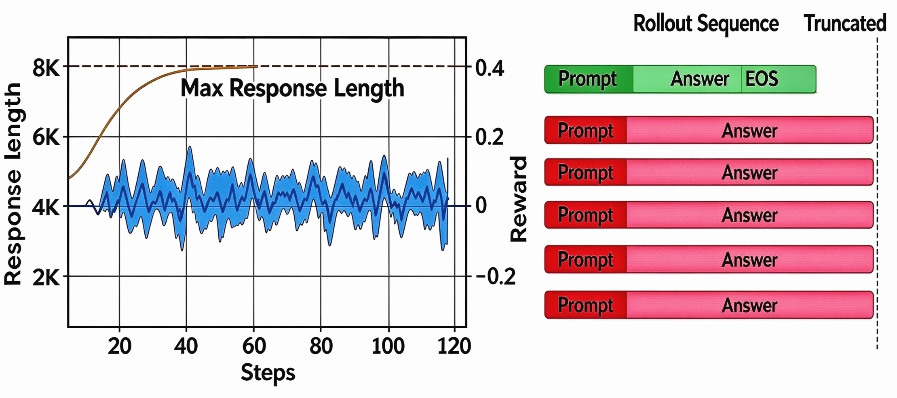
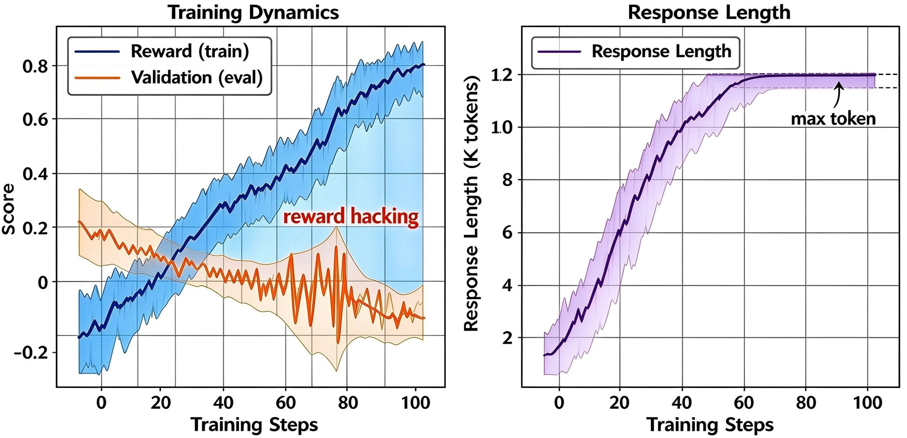
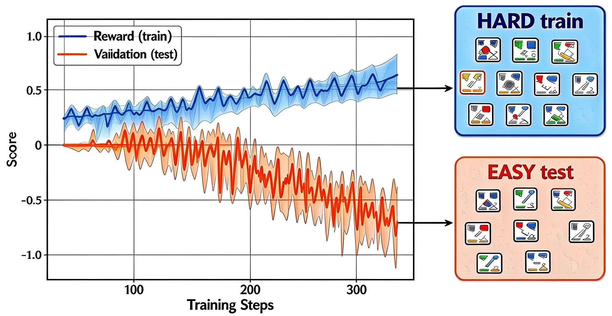
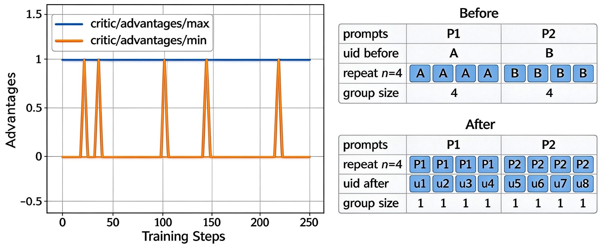
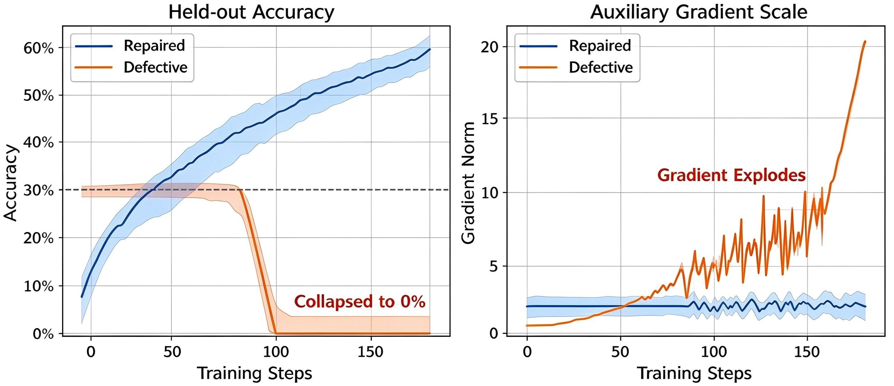

<p align="center">
  <a href="https://thinking-space.github.io/AutoRLBench/"></a>
</p>

<p align="center">
  <a href="https://thinking-space.github.io/AutoRLBench/"></a>
  <a href="https://thinking-space.github.io/AutoRLBench/#leaderboard"></a>
  <a href="https://thinking-space.github.io/AutoRLBench/#tasks"></a>
  <a href="https://thinking-space.github.io/AutoRLBench/contribute.html"></a>
  <a href="LICENSE"></a>
  <a href="README_zh.md"></a>
</p>

A benchmark and open call for valuable, reproducible RL runs. Each task is a real training run that went wrong. The agent has to find the root cause (**issue**) and, where a repaired run exists, fix it and rerun (**solution**).

<p align="center"></p>

## 🚀 News 

- **17 Nov 2026** — We’ve just updated the AutoRLBench [blog](https://thinking-space.github.io/AutoRLBench/blog.html) with what we learned from evaluating agents on real RL training failures.
- **2 Nov 2026** — We release the first version of the task list: 18 tasks, 13 of which support solution-level evaluation.
- **24 Oct 2026** — Call for contributions officially open, and Kimi-K3.1-Pro added to the leaderboard.
- **19 Oct 2026** — GitHub repo and website released.

## Leaderboard

AutoRLBench Leaderboard, issue + solution evaluation. Overall is the combined pass rate across all evaluated runs (issue + solution): passes over total runs, not an average of the two levels.

| # | Model | Agent | Issue Score | Solution Score | Overall |
| ---: | --- | --- | ---: | ---: | ---: |
| 1 | DeepSeek-V4.1-Flash | Claude Code | 43.1 % | 22.7 % | **37.0 %** |
| 2 | GPT-6.1-Sol | Codex | 39.2 % | 22.7 % | **34.2 %** |
| 3 | Gemini-4-Argon | Claude Code | 27.0 % | 50.0 % | **34.0 %** |
| 4 | GLM-5.3 | Claude Code | 35.3 % | 22.7 % | **31.5 %** |
| 5 | GPT-6-Astra | Codex | 33.3 % | 22.7 % | **30.1 %** |
| 6 | Grok-4.7 | Grok Build | 29.4 % | 22.7 % | **27.4 %** |
| 7 | Qwen3.8-Max | Qwen Code | 23.5 % | 27.3 % | **24.7 %** |
| 8 | Kimi-K3.1-Pro | Claude Code | 23.5 % | 22.7 % | **23.3 %** |
| 9 | Claude-Fable-5.1 | Claude Code | 20.0 % | 22.7 % | **20.8 %** |
| 10 | Kimi-K3 | Claude Code | 5.9 % | 13.6 % | **8.2 %** |
| 11 | DeepSeek-V4-Pro | Claude Code | 6.0 % | 4.5 % | **5.6 %** |

## Tasks

Six types, one representative task each. The types come from where in the RL pipeline the failure lives:

<table>
<tr>
<td width="50%" valign="top">
<a href="tasks/configuration/verl_grpo_rollout_top_p_off_policy/">

</a>
<strong>Configuration</strong> · issue · solution<br>
<a href="tasks/configuration/verl_grpo_rollout_top_p_off_policy/"><b>Nucleus-sampled rollouts trained as if on-policy</b></a><br>
Sampling rollouts with <code>top_p=0.5</code> while the update scores the full softmax; entropy derails a fifth of the rollouts.
</td>
<td width="50%" valign="top">
<a href="tasks/reward/slime_retool_length_reward_bonus/">

</a>
<strong>Reward</strong> · issue · solution<br>
<a href="tasks/reward/slime_retool_length_reward_bonus/"><b>Length bonus reward hack</b></a><br>
An unconditional length bonus teaches the policy to write longer, not better.
</td>
</tr>
<tr>
<td width="50%" valign="top">
<a href="tasks/data/verl_taco_difficulty_mismatch/">

</a>
<strong>Data</strong> · issue<br>
<a href="tasks/data/verl_taco_difficulty_mismatch/"><b>Training data is too hard</b></a><br>
Train is TACO <code>VERY_HARD</code> while validation is <code>EASY</code>; held-out accuracy ends below its start.
</td>
<td width="50%" valign="top">
<a href="tasks/algorithm/verl_grpo_advantage_broadcast/">

</a>
<strong>Algorithm</strong> · issue<br>
<a href="tasks/algorithm/verl_grpo_advantage_broadcast/"><b>GRPO advantage broadcast</b></a><br>
An advantage broadcast replaces per-sample advantages, causing policy collapse.
</td>
</tr>
<tr>
<td width="50%" valign="top">
<a href="tasks/data/verl_taco_difficulty_mismatch/">

</a>
<strong>Data</strong> · issue<br>
<a href="tasks/data/verl_taco_difficulty_mismatch/"><b>Training data too hard</b></a><br>
Training on VERY_HARD while validating on EASY, held-out accuracy falls below the starting point.
</td>
<td width="50%" valign="top">
<a href="tasks/infrastructure/verl_moe_token_normalization/">

</a>
<strong>Infrastructure</strong> · issue · solution<br>
<a href="tasks/infrastructure/verl_moe_token_normalization/"><b>MoE auxiliary gradients miss token normalization</b></a><br>
The per-token loss callback omits the token count, so MoE z-loss gradients are never normalized.
</td>
</tr>
</table>

## How a task works

```text
prepare ──▶ agent ──▶ [rerun] ──▶ verifier
  │           │          │            │
  │           │          │            └─ issue:    LLM judge on agent_answer.md vs. hidden oracle
  │           │          │               solution: a metric threshold on the rerun's logs
  │           │          └─ solution only: the harness re-runs the experiment on the agent's
  │           │             workspace, per the task's run_spec.json
  │           └─ reads instruction.md and a writable copy of workspace/
  └─ fetches pinned models and datasets (the only stage with network)
```

Each stage runs in its own container from the same prebuilt image. Oracles and verifiers are mounted only into the verifier stage.

At the solution level the agent repairs the workspace and submits `report.md` — it does **not** launch training itself. The harness clears the task's log roots, re-runs the experiment on the repaired workspace, and grades only that fresh run. No `report.md`, no rerun and no grading: the task scores 0.

## Repository layout

| Path | Contents |
| --- | --- |
| [`tasks/`](tasks/) | Benchmark tasks, grouped by type |
| [`autorlbench/`](autorlbench/) | Evaluation harness: task loader, validator, runtimes, agent adapters, CLI |
| [`ENVIRONMENTS.md`](ENVIRONMENTS.md) | The eight fixed shared environment images every task runs in |
| [`skills/package-task/`](skills/package-task/) | Agent skill that turns a raw task into a task |
| [`skills/validate-task/`](skills/validate-task/) | Agent skill that reviews a task's experiment, evidence, and grading |
| [`tests/`](tests/) | Harness unit tests |
| [`page/`](page/) | Website source, deployed to GitHub Pages |

## Task layout

```text
tasks/<type>/<task_id>/
├── README.md               # summary, difficulty, reference solution, verification
├── task.toml               # metadata and environment image
├── run_spec.json            # harness rerun command, environment, timeout, and log roots
├── workspace/              # the run as the agent sees it: code, config, logs, metrics
├── environment/prepare.sh  # fetches pinned models and datasets (only stage with network)
└── evaluations/
    ├── issue/              # instruction.md · oracle.md · verifier/
    └── solution/           # instruction.md · oracle/ · verifier/ (grader_spec.json)
```

## Quick start

The fastest way to run an evaluation is to hand it to an AI agent. Clone this repo, open your agent in it, and paste this one line:

```text
Read skills/harbor-evaluate/SKILL.md and follow it to evaluate <model> with agent <agent> on <task-root> at the issue level — e.g. tasks/reward/trl_gsm8k_threaded_reward_order with agent codex.
```

The agent picks up the [harbor-evaluate skill](skills/harbor-evaluate/SKILL.md) and runs the whole flow for you: environment and credential setup, launching and monitoring the trial, validity checks on each `report.json`, and score aggregation. Swap `issue` for `solution` to evaluate repairs instead.

To drive the harness yourself:

```bash
# Validate a task
python3 -m autorlbench validate tasks/reward/slime_retool_length_reward_bonus

# Rerun a task's experiment on its original workspace (prepare + run_spec.json,
# no agent, no verifier) — for task submitters to confirm their environment works
python3 -m autorlbench rerun tasks/reward/slime_retool_length_reward_bonus

# Run an agent through Harbor (pip install harbor)
python3 -m autorlbench harbor-evaluate tasks/reward --agent codex --model <model>
```

`harbor-evaluate` records each run under `outputs/harbor-evaluate/<task_id>/<agent>-<model>/<timestamp>/`: the command as an executable `command.sh`, the effective Harbor command, a live `prepare.log` and `harbor.log` (both `tail -f`-able while the run is going), and the final `report.json`. Only stage-start lines go to the terminal; everything else lands in those log files.

`rerun` is the submitter-side environment check: the framework pulls the digest-pinned shared image, launches prepare and rerun containers from it, runs `prepare.sh`, and then starts the experiment that the task-root `run_spec.json` declares — no agent, no verifier, no report gate. Each run records itself under `outputs/rerun/<task_id>/<timestamp>/` in the same layout as `harbor-evaluate`: the command as an executable `command.sh`, live `tail -f`-able `prepare.log` and `rerun.log`, the final `report.json`, the experiment's logs under `results/`, and the workspace copy. For contribution review, a few training steps in `rerun.log` are enough to show that the image and `prepare.sh` can start the experiment; the experiment's own exit code is not judged, since a buggy run is expected to fail.

Run `python3 -m autorlbench --help` for every option. The issue verifier calls an OpenAI-compatible judge through `OPENAI_BASE_URL` and `OPENAI_API_KEY`.

## Contributing

We welcome both problematic runs and healthy reference runs. Bring the issue materials, or add the repaired run when it exists; an agent does the packaging — inside a clone of this repository, using the [package-task](skills/package-task/SKILL.md) skill. Every task runs in one of the eight fixed shared images in [ENVIRONMENTS.md](ENVIRONMENTS.md): run your buggy run in one of them and ship that run's artifacts. There is no custom-image exception. The final contribution gate is the [validate-task](skills/validate-task/SKILL.md) review, including the startup rerun logs. Contribute **two valid tasks** and you become a co-author on the benchmark paper. See [CONTRIBUTING.md](CONTRIBUTING.md) and the [contribution guide](https://thinking-space.github.io/AutoRLBench/contribute.html).

## License

Apache-2.0. Each task's workspace keeps the license of its upstream code.
