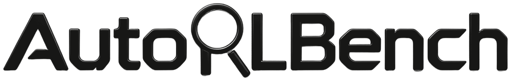
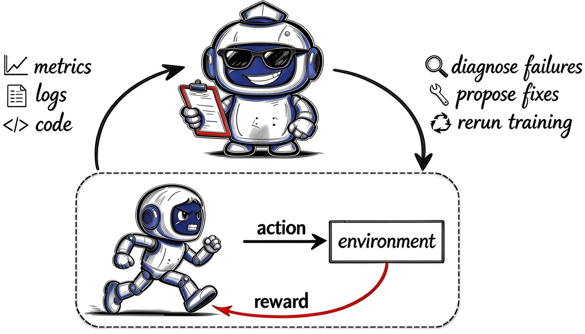
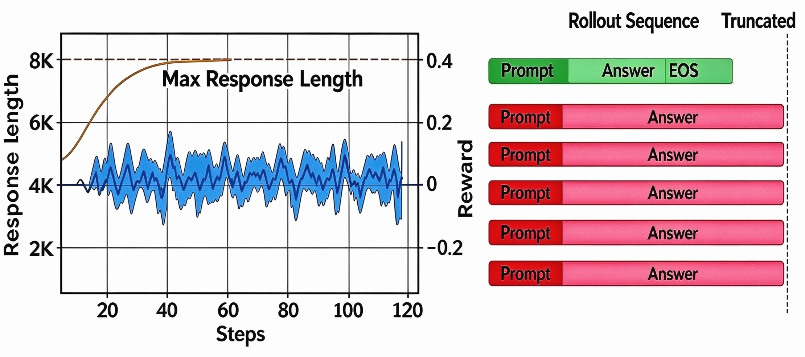
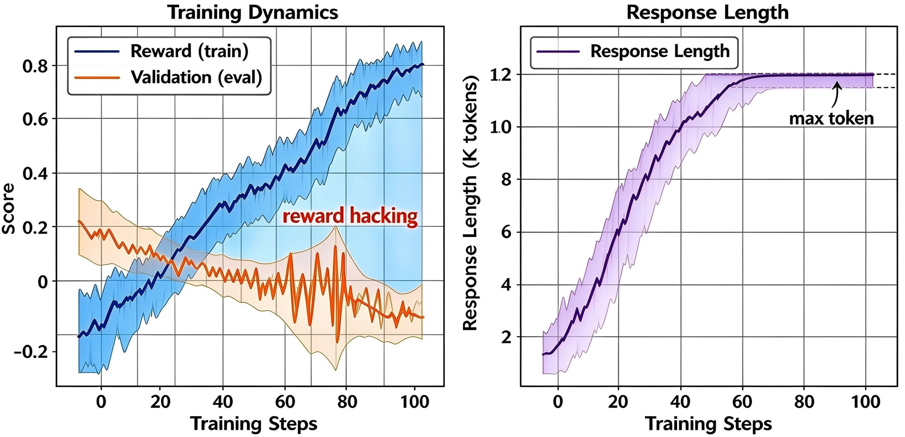
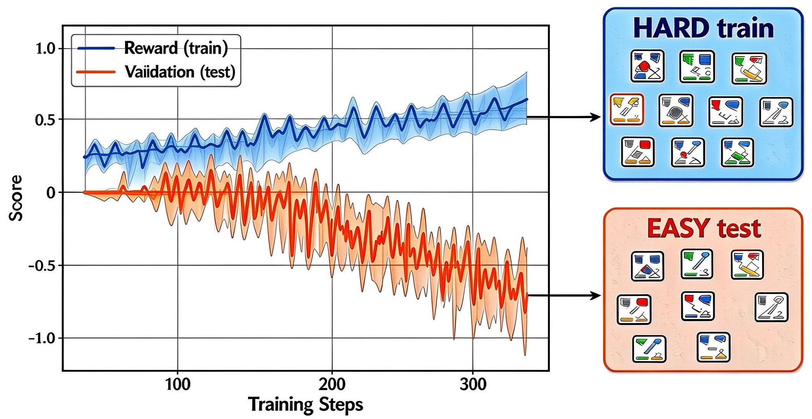
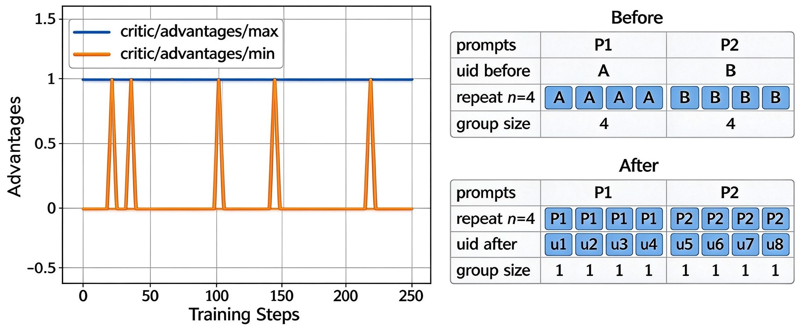
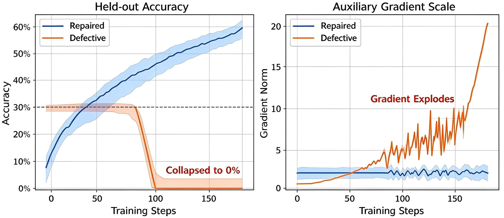

<p align="center">
  <a href="https://thinking-space.github.io/AutoRLBench/"></a>
</p>

<p align="center">
  <a href="https://thinking-space.github.io/AutoRLBench/"></a>
  <a href="https://thinking-space.github.io/AutoRLBench/#leaderboard"></a>
  <a href="https://thinking-space.github.io/AutoRLBench/#tasks"></a>
  <a href="https://thinking-space.github.io/AutoRLBench/contribute.html"></a>
  <a href="LICENSE"></a>
  <a href="README.md"></a>
</p>

一个面向真实、可复现 RL 训练运行的 benchmark，也是一个开放征集。每个任务都来自一次真实跑坏的训练：agent 要找到根因（**issue**），有修复版本的任务还要改好并重跑（**solution**）。

<p align="center"></p>

## 🚀 新闻
- **2026 年 11 月 6 日** — 公开第二版任务列表：共 32 个任务，其中 24 个支持 solution 级评测。
- **2026 年 11 月 2 日** — 公开第一版任务列表：共 18 个任务，其中 13 个支持 solution 级评测。
- **2026 年 10 月 24 日** — 正式开始征集贡献（call for contributions），并在 leaderboard 中加入 Kimi-K3.1-Pro 评测结果。
- **2026 年 10 月 19 日** — 发布 GitHub 仓库与网站。

## Leaderboard

AutoRLBench Leaderboard，issue + solution 双档成绩。总分为全部已评测 run（issue + solution）的合并通过率（通过数 / 总数），不是两档分数的平均。

| # | 模型 | Agent | Issue 分数 | Solution 分数 | 总分 |
| ---: | --- | --- | ---: | ---: | ---: |
| 1 | DeepSeek-V4.1-Flash | Claude Code | 30.0 % | 23.8 % | **28.2 %** |
| 2 | Gemini-4-Argon | Claude Code | 13.9 % | 53.3 % | **25.5 %** |
| 3 | GLM-5.3 | Claude Code | 26.0 % | 23.8 % | **25.4 %** |
| 3 | GPT-6.1-Sol | Codex | 24.0 % | 28.6 % | **25.4 %** |
| 5 | GPT-6-Astra | Codex | 24.0 % | 23.8 % | **23.9 %** |
| 6 | Qwen3.8-Max | Qwen Code | 20.0 % | 28.6 % | **22.5 %** |
| 7 | Grok-4.7 | Grok Build | 18.0 % | 23.8 % | **19.7 %** |
| 7 | Claude-Fable-5.1 | Claude Code | 18.0 % | 23.8 % | **19.7 %** |
| 9 | Kimi-K3.1-Pro | Claude Code | 14.0 % | 23.8 % | **16.9 %** |
| 10 | Kimi-K3 | Claude Code | 4.0 % | 14.3 % | **7.0 %** |
| 11 | DeepSeek-V4-Pro | Claude Code | 4.1 % | 4.8 % | **4.3 %** |


## 任务

六个 domain，每个放一个代表性任务。domain 按失败发生在 RL 流程的哪一环来划分：

<table>
<tr>
<td width="50%" valign="top">
<a href="tasks/configuration/verl_grpo_rollout_top_p_off_policy/">

</a>
<strong>Configuration</strong> · issue · solution<br>
<a href="tasks/configuration/verl_grpo_rollout_top_p_off_policy/"><b>核采样 rollout 被当作在策略训练</b></a><br>
用 <code>top_p=0.5</code> 采样 rollout，更新却在完整 softmax 上打分；熵失控让五分之一的 rollout 脱轨。
</td>
<td width="50%" valign="top">
<a href="tasks/reward/slime_retool_length_reward_bonus/">

</a>
<strong>Reward</strong> · issue · solution<br>
<a href="tasks/reward/slime_retool_length_reward_bonus/"><b>长度奖励劫持</b></a><br>
无条件长度奖励让策略学会写得更长，而不是写得更好。
</td>
</tr>
<tr>
<td width="50%" valign="top">
<a href="tasks/data/verl_taco_difficulty_mismatch/">

</a>
<strong>Data</strong> · issue<br>
<a href="tasks/data/verl_taco_difficulty_mismatch/"><b>训练数据太难</b></a><br>
训练集是 TACO <code>VERY_HARD</code>、验证集是 <code>EASY</code>，held-out 准确率跌回起点以下。
</td>
<td width="50%" valign="top">
<a href="tasks/algorithm/verl_grpo_advantage_broadcast/">

</a>
<strong>Algorithm</strong> · issue<br>
<a href="tasks/algorithm/verl_grpo_advantage_broadcast/"><b>GRPO advantage 广播</b></a><br>
advantage 广播替换了逐样本 advantage，导致策略崩溃。
</td>
</tr>
<tr>
<td width="50%" valign="top">
<a href="tasks/data/verl_taco_difficulty_mismatch/">

</a>
<strong>Data</strong> · issue<br>
<a href="tasks/data/verl_taco_difficulty_mismatch/"><b>训练数据太难</b></a><br>
训练集是 TACO <code>VERY_HARD</code>、验证集是 <code>EASY</code>，held-out 准确率跌回起点以下。
</td>
<td width="50%" valign="top">
<a href="tasks/infrastructure/verl_moe_token_normalization/">

</a>
<strong>Infrastructure</strong> · issue · solution<br>
<a href="tasks/infrastructure/verl_moe_token_normalization/"><b>MoE 辅助梯度缺少 token 归一化</b></a><br>
per-token loss 回调缺少 token 计数，MoE z-loss 梯度从未被归一化。
</td>
</tr>
</table>

## 一个任务怎么跑

```text
prepare ──▶ agent ──▶ [rerun] ──▶ verifier
  │           │          │            │
  │           │          │            └─ issue:    LLM judge 比对 agent_answer.md 与隐藏 oracle
  │           │          │               solution: 按指标门槛判定重跑产出的日志
  │           │          └─ 仅 solution：harness 按任务的 run_spec.json，
  │           │             在 agent 修好的 workspace 上重跑实验
  │           └─ 读取 instruction.md 与一份可写的 workspace/
  └─ 拉取钉死版本的模型与数据集（唯一联网的阶段）
```

各阶段各自起容器，用的是同一个预构建镜像。oracle 与 verifier 只挂进 verifier 阶段。

solution 层里 agent 只负责修 workspace 并提交 `report.md`，**不自己启动训练**。harness 会清掉任务声明的日志目录，在修好的 workspace 上重跑实验，只对这一遍的新日志判分。没交 `report.md` 就不重跑也不判分，直接记 0 分。

## 目录

| 路径 | 内容 |
| --- | --- |
| [`tasks/`](tasks/) | 按 domain 分组的 benchmark 任务 |
| [`autorlbench/`](autorlbench/) | 评测框架：任务加载、校验、运行时、agent 适配器、CLI |
| [`ENVIRONMENTS.md`](ENVIRONMENTS.md) | 全部任务运行的 8 个固定共享环境镜像 |
| [`skills/package-task/`](skills/package-task/) | 把 raw task 打包成任务的 agent skill |
| [`skills/validate-task/`](skills/validate-task/) | 检查任务实验、证据和评分的 agent skill |
| [`tests/`](tests/) | 框架单元测试 |
| [`page/`](page/) | 网站源码，部署到 GitHub Pages |

## 任务结构

```text
tasks/<domain>/<task_id>/
├── README.md               # 摘要、难度、参考解、判分方式
├── task.toml               # 元数据与环境镜像
├── run_spec.json            # harness 重跑命令、环境、超时与日志根目录
├── workspace/              # agent 看到的那次运行：代码、配置、日志、指标
├── environment/prepare.sh  # 拉取钉死版本的模型与数据集（唯一联网阶段）
└── evaluations/
    ├── issue/              # instruction.md · oracle.md · verifier/
    └── solution/           # instruction.md · oracle/ · verifier/（grader_spec.json）
```

## 快速开始

```bash
# 校验一个任务
python3 -m autorlbench validate tasks/reward/slime_retool_length_reward_bonus

# 在原始 workspace 上重跑任务的实验（prepare + run_spec.json，
# 不含 agent、不含 verifier）—— 供任务提交者确认环境有效
python3 -m autorlbench rerun tasks/reward/slime_retool_length_reward_bonus

# 通过 Harbor 运行 agent（pip install harbor）
python3 -m autorlbench harbor-evaluate tasks/reward --agent codex --model <model>
```

`rerun` 是面向任务提交者的环境检查：框架拉取 digest-pinned 共享镜像，拉起对应的 prepare 与 rerun 容器，先运行 `prepare.sh`，再按任务根目录 `run_spec.json` 声明的实验启动训练——不跑 agent、不跑 verifier、没有 report 门槛。每次运行记录在 `outputs/rerun/<task_id>/<时间戳>/` 下，布局与 `harbor-evaluate` 一致：可执行的 `command.sh`、可 `tail -f` 的实时 `prepare.log` 与 `rerun.log`、最终的 `report.json`、实验日志 `results/`，以及 workspace 拷贝。贡献审核只要求 `rerun.log` 中出现几个真实训练 step，足以证明镜像和 `prepare.sh` 能把实验启动起来；实验自身的退出码不用于判定，因为 buggy run 本来就预期失败。

全部参数见 `python3 -m autorlbench --help`。issue 档的 verifier 通过 `OPENAI_BASE_URL` 与 `OPENAI_API_KEY` 调用 OpenAI 兼容的 judge。

## 贡献

有问题的 run 和健康的对照 run 都欢迎。带上 issue 所需材料即可，已有修复版本时再补上 solution 运行；打包由 agent 在本仓库的 clone 中、用 [package-task](skills/package-task/SKILL.md) skill 完成。所有任务都跑在 [ENVIRONMENTS.md](ENVIRONMENTS.md) 中 8 个固定的共享镜像之一上：请在这 8 个环境之一里跑你的 buggy run，并提交那次运行的产物；没有 custom image 例外。最终贡献门槛是 [validate-task](skills/validate-task/SKILL.md) 审查，包括启动性 rerun 的日志。贡献**两个有效任务**即可成为 benchmark 论文的共同作者。详见 [CONTRIBUTING.md](CONTRIBUTING.md) 与[贡献指南](https://thinking-space.github.io/AutoRLBench/contribute.html)。

## 许可

Apache-2.0。各任务的 workspace 沿用其上游代码的许可。
