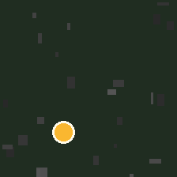

# Reproducing an over-budget rollout cache with online SmolVLM GRPO

Run the buggy arm to train a policy whose rollout worker holds more image-embedding storage than its cache budget permits. The reference arm repeats the same online training from the same checkpoint with one change at cache admission. Both arms keep the same image inputs, sampling seed, budget, LRU policy and trainable parameters.

## Measured run on one NVIDIA H200

Each arm completed 16 policy updates and sampled 1,024 answers. There were 117 groups containing both successful and unsuccessful answers, and every update changed the adapter. The initial weights, prompts, scenes, sampled actions and rewards matched across arms. The encoder-output SHA-256 and post-update policy SHA-256 matched at every step. The maximum absolute difference between the sampled-token logprobs was 0. [Buggy step log](results/h200/buggy.jsonl) · [Fixed step log](results/h200/fixed.jsonl) · [Paired verification](results/h200/paired.json) · [Recorded shared image](results/h200/environment.json)

| H200 measurement, one seeded run per arm | Upstream bug | Compact on admission |
| --- | ---: | ---: |
| Cache budget | 360 KiB | 360 KiB |
| Logical bytes charged after step 2 | 360 KiB | 360 KiB |
| Actual live storage after step 1 | 576 KiB | 360 KiB |
| Actual live storage after step 2 (peak) | 864 KiB | 360 KiB |
| Steps over budget | 16/16 | 0/16 |
| Image lookups / hits / evictions | 128 / 48 / 75 | 128 / 48 / 75 |
| Held-out correct answers after training | 16/32 | 16/32 |

Step 2 exposes the cause. One entry from the first batch keeps its entire 576 KiB allocation live. The four new entries share another 288 KiB allocation. The original LRU therefore holds 864 KiB while reporting 360 KiB. With the fix, the same five live keys own five independent 72 KiB allocations. This removes 504 KiB of live cache storage at that boundary. The single-seed experiment measures this accounting failure. The historical robotics job did not record per-entry storage ownership.

An independent Apple MPS run used the same public model, sampling scheme and 16-step workload. Its within-device comparison also produced 16 over-budget steps in the buggy arm and 0 in the reference arm. The evidence spans two device backends. CUDA used BF16 and MPS used FP16, so policy hashes are compared within each pair. [MPS verification](results/mps/paired.json)

## What actually runs

Each step issues eight image-and-text requests to the public SmolVLM-256M-Instruct checkpoint. The environment renders a beacon in an RGB scene. A user asks whether it is on the left or on the right. The actor samples eight responses per request from the decoder's two admissible next tokens, “ No” and “ Yes”. A correct response earns one, an incorrect response earns zero. The trainer normalizes rewards within each group and applies one GRPO gradient update with Adam to a two-logit residual on the pretrained language head. The frozen vision encoder, connector and language decoder run on the accelerator. Freezing the vision tower permits an image embedding to be reused across policy updates.

Every fourth batch starts with eight fresh scenes. In the next three batches, four scenes recur from the preceding batch and four are new. Five image embeddings fit the cache. This small working set makes partial eviction observable within a short run. A held-out evaluation uses separate scenes and bypasses the rollout cache.

The prefill path runs in the rollout process. The input adapter supplies image items, placeholder offsets and the vision callback to SGLang's historical `_get_chunked_prefill_embedding`. That function calls `_batch_encode_per_image_misses`, which batches the actual encoder forward, splits its concatenated result and performs LRU lookup and insertion. With Transformers 4.52.4, Idefics3's own `get_image_features` returns the flattened output of the vision transformer and connector. The text decoder consumes the reassembled embeddings at the original image-token positions. Before training, a separate two-prompt check compares a full Hugging Face forward with direct vision encoding followed by text decoding. This check bypasses the LRU. During training, the paired verifier separately compares the SHA-256 of the scheduler's reassembled visual tensor at every step. [SGLang batch and split](https://github.com/sgl-project/sglang/blob/02b5e123c490c988d21526d0dd7837fefdd0e1da/python/sglang/srt/managers/mm_schedule.py#L323-L405) · [Idefics3 public vision code](https://github.com/huggingface/transformers/blob/v4.52.4/src/transformers/models/idefics3/modeling_idefics3.py#L705-L744) · [Public checkpoint](https://huggingface.co/HuggingFaceTB/SmolVLM-256M-Instruct/tree/d039ab0d4b9311b617e8ffec1d06c8464364aeb3)

The loader verifies the SHA-256 of both upstream Python files. If an exact installed revision is available, it imports the modules. Otherwise it compiles the unchanged cache and prefill definitions from those files with the import-time server dependencies isolated. The recorded `cache.backend` identifies the path used. This experiment exercises SGLang's historical prefill and cache code in process. It does not launch the distributed SGLang HTTP server.

### A repeated image from the actual H200 rollouts



The scene above appeared at step 1, slot 8, with the question “Is the illuminated beacon on the left?”. 6/8 sampled answers earned a reward. At step 2, slot 4, the actor received the same pixels with the question “Is the illuminated beacon on the right?”. 2/8 answers earned a reward. Its embedding was a cache hit on the second request. [Both rollout groups, including token logprobs](results/h200/repeated-scene-rollouts.json)

## Run on one CUDA GPU

From this directory, mount the experiment read-only and use a writable directory for dependencies, model files and results. The first invocation fetches hash-checked public inputs and a pinned Python overlay. Both training arms can run with networking disabled. Pass a free GPU index in `GPU`. [AutoRLBench shared image list](https://github.com/Thinking-Space/AutoRLBench/blob/main/ENVIRONMENTS.md)

```bash
IMAGE='ghcr.io/yhyayi/autorlbench:vllm0.6.3-torch2.4.0-flashattn2.6.3-cu121-py3.10@sha256:f5dbe597c6dad59dcbdee5e363e645f96656f9bea94641f3438f8b2f639c5b3d'
GPU=0
mkdir -p "$PWD/work"
docker run --rm -v "$PWD:/case:ro" -v "$PWD/work:/work" \
  --entrypoint /bin/bash "$IMAGE" /case/environment/prepare.sh /work
docker run --rm --gpus "device=$GPU" --network none --shm-size=1g \
  -v "$PWD:/case:ro" -v "$PWD/work:/work" \
  --entrypoint /bin/bash "$IMAGE" /case/run_pair.sh /work /work/results cuda
```

For an air-gapped execution, populate `smolvlm/` and `upstream/` once with `python prepare.py DATA`, then supply the wheels to `environment/prepare.sh DATA WHEELHOUSE`. To run only the failing configuration in the prepared environment, use the command below. Its training log exposes the over-budget cache on the first update.

```bash
PYTHONPATH=/work/runtime python3 /case/train_vlm.py --device cuda --mode buggy \
  --model-dir /work/smolvlm --source-dir /work/upstream --output /work/buggy.jsonl
```

The run script starts each arm in a separate Python process. `verify_pair.py` reads the two JSONL logs using only the Python standard library. You can run it on the checked-in evidence without a GPU or a model download.

```bash
python3 verify_pair.py results/h200/buggy.jsonl results/h200/fixed.jsonl
python3 verify_pair.py results/mps/buggy.jsonl results/mps/fixed.jsonl
```

The independent macOS run used native Apple MPS, PyTorch 2.14.0, torchvision 0.29.0, Transformers 5.12.1 and FP16. In that native environment, use a fresh data directory for the Apple run.

```bash
python3 prepare.py mac-data
bash run_pair.sh mac-data mac-results mps
```

## How to read the evidence

- Each step records the eight scene IDs, question IDs, all 64 sampled answer token IDs, rewards, behavior logprobs, mixed-reward group count, gradient norm, parameter-update norm and post-update policy SHA-256.
- After each prefill, the runner releases the request's assembled image tensor. It records the LRU's live keys and byte counter, deduplicates the backing storages of its live entries by device and allocation, and sums their sizes. Any lookup table and split-output references local to SGLang's scheduler have already gone out of scope. Process allocator readings are logged separately.
- The verifier recomputes each reward from the scene seed, question and sampled answer token. It checks that real updates occurred, that repeat-image hits, evictions and multi-image split batches were observed, and that the two arms produced matching embeddings, actions, rewards, behavior logprobs and policy updates. It requires the buggy arm to exceed its storage budget and the repaired arm to respect it throughout.
- The measured violation concerns live storage referenced by the rollout image LRU. Device allocator reservation, text prefix KV cache size, historical job OOMs, end-to-end throughput and multi-seed learning performance are separate quantities.

## The reference change

The upstream LRU charges `numel() * element_size()` and stores the encoder's split view. A single surviving view can keep the allocation for an entire miss batch alive. The reference patch applies after the ordinary admission and eviction checks and immediately before storing the entry. It creates a compact allocation only when the existing storage is oversized and preserves the entry's other fields. [Upstream cache insertion](https://github.com/sgl-project/sglang/blob/02b5e123c490c988d21526d0dd7837fefdd0e1da/python/sglang/srt/mem_cache/multimodal_cache.py#L102-L121)

```diff
+        tensor = embedding.embedding
+        if tensor.untyped_storage().nbytes() > data_size:
+            embedding = replace(embedding, embedding=tensor.clone(memory_format=torch.contiguous_format))
         self.mm_cache[mm_hash] = embedding
```

A split view can already be contiguous while still owning a reference to its batch. Calling `.contiguous()` in that case returns the same view. Shrinking or disabling the LRU would change the rollout workload's hit sequence. The paired logs let a reviewer check both failure modes.
