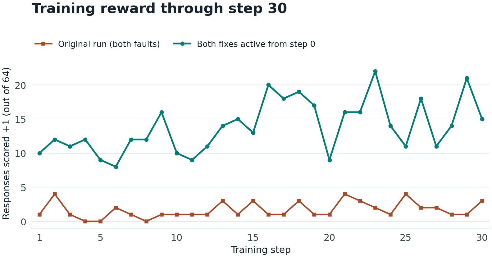

# Quantized rollouts in a math RL run

We train Nemotron-Research-Reasoning-Qwen-1.5B on Skywork-OR1 math with
REINFORCE++ and quantized vLLM rollouts. AIME24 improves from 31/240 to
41/240 by step 8, then stays at 41/240 through step 30. During training, the
scorer marks 1,672 of 1,920 answers invalid, and three batches produce no
policy gradient.

| | |
| --- | --- |
| **Author** | Yong Yan |
| **Affiliation** | Tsinghua University |
| **Type** | Algorithm |
| **Domain** | Math RL |
| **Tags** | `policy-gradient` `quantized-rollout` |
| **Framework** | VeRL with vLLM 0.24 |
| **Run time** | About 1.5 hours for 30 training steps |
| **Resources** | 4 GPUs |

## Difficulty

At each step, vLLM generates one answer for each of 64 Skywork prompts
with a 16,384-token limit and a K2/V3-quantized KV cache. It sends the
sampled tokens and their log probabilities to the trainer. The trainer
scores the final answers, computes REINFORCE++ advantages, and updates
the actor in one PPO minibatch.

The run completes all 30 steps, yet two signals tell different parts of the
story. At steps 4, 5, and 8, all 64 answers receive a negative reward and
the policy gradient is zero. PPO clipping also stays at zero across the
other 27 steps, even though those steps have nonzero gradients. At both
held-out checkpoints, 239 of 240 answers reach a natural stop. The logs,
six raw batches, and training labels let the solver check how the scorer
treated individual answers and trace which probabilities the actor used.

## Reference solution

- **issue**: the trainer hands the actor the rollout log probabilities,
  but the single-minibatch path replaces them with a detached copy of the
  actor's current scores. The ratio is then 1 and PPO clipping never
  activates. Separately, the scorer looks for a Minerva-style `Answer:`
  field in the last 300 characters. Correct boxed answers can receive
  negative reward, leaving a batch with identical rewards and zero
  normalized advantages.

## Verification

- **issue**: the judge checks the two causal paths and recorded evidence
  against the hidden oracle. Replaying the original scorer reproduced all
  1,920 recorded rewards. It gave positive reward to 50 answers and missed
  another 262 whose boxed answer matched the training label exactly.

Each point counts answers that received +1 from that run's training scorer,
out of 64. The original run logs 50 positive rewards over 30 steps, and
the run with both fixes logs 415. The runs use different training scorers
and share the same AIME24 evaluator.

Both runs start at 31/240 on AIME24. At step 30, the original run scores
41/240 and the run with both fixes scores 59/240, a difference of 7.50
percentage points (95% CI [+0.83, +14.17], paired bootstrap over 30
questions with eight samples each). The task has an Issue tier because
the comparison has one training run per condition and needs more runs
to calibrate a Solution threshold.
