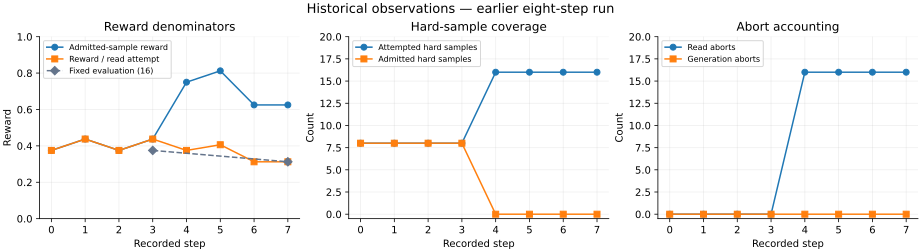

# Data-relocation review / 数据迁移审查

## 中文背景与验收

本题来自一次人为注入的 JustRL-II / miles PPO 数学训练数据读取事故。应用代码
用样本 ID 查找文件；困难样本迁移后，旧映射仍指向原路径。历史运行将缺失文件
转成 ABORTED 样本，经 `check_no_aborted` 过滤后继续重采样，训练批次最终只剩
容易样本。因此训练奖励的升高可以来自样本分布变化，不能据此判断模型能力提高。
模型学习的是解数学题；ID 到文件路径的映射属于应用代码。这不是未修复的上游缺陷。

当前版本是 CPU 数据契约调试题。`environment/scene/` 直接随包提供已核验历史
场景中的原始真实数据：64 条训练样本（32 easy + 32 hard）和 16 条评估样本
（8 easy + 8 hard），来自冻结的 UltraData-RL-2609 Math 选择集。样本 ID、题目、
答案和内容哈希保持不变。easy/hard 及历史准确率是作者提供的历史分层，不是本次
重新测量的难度或模型表现。评估集保留用于完整性与历史背景，当前不运行模型评估。

Agent 收到中性题面，判断收到的当前实现是 healthy 还是 unhealthy。历史日志
不足以证明当前代码有错；健康实现可以不改代码直接提交。若需修复，提交界面是
`loader.py` 中受限的 `resolve(root, record) -> relative_path` 查询。

解法通过条件须同时成立：

1. `report.md` 正确判断**修改前**的实现，并包含非空解释。解法评分不语义评审
   正文；issue 模式仍由独立 judge 评审诊断。
2. `check_reads.py` 通过提交的查询逐一读取全部原始 64 条训练样本。固定读取器
   独立核对 ID、实际字节的 SHA-256 和难度，不能替换、删减或修改样本。
3. 在临时副本中，将全部训练载荷移到本次新生成、不可预知的目录，打乱 catalog
   顺序，并在旧路径放置错误字节的诱饵，再核验同一批 64 条样本的 ID 和内容。
   仅将 `live/hard` 硬编码替换成 `archive/hard` 不满足该契约。
4. 拒绝未知 ID、已有或缺失路径上的错误哈希、catalog 匹配但文件缺失，以及
   catalog 匹配不唯一的请求。

隐藏 verifier 独立重新执行上述行为检查，不采用预先写入的成功 JSON 或历史
日志作为通过证据。正确报告和全部行为检查缺一不可；健康提交也接受相同检查。

默认 `run_spec.json` 只运行 Python 标准库 CPU 检查，`gpus = 0`。Prepare 只复制
随包环境与场景，无需训练、模型、模型或数据下载，也无需 Hugging Face 托管。
仍保留现有按 digest 固定的共享 miles 镜像；镜像可能较大，首次拉取可能需要
网络。`provenance/evaluate_submission.py` 为外部 agent 已产出的工作区评分：
prepare 与 verifier 在不同 CPU Docker 容器中运行，均禁用网络，verifier 输入
只读。该 CLI 不启动 LLM agent。上游默认 Harbor 自动 agent 工作流拒绝需要
阶段隔离的任务，目前不支持本题；本地 checker 示例也不证明部署隔离。

[交付说明](provenance/DELIVERY.md)提供独立提交物评分、本地检查及健康对照命令。
[安全说明](provenance/SECURITY.md)说明固定小样本、答案记忆、窄接口与隔离假设。
`provenance/receipts/` 的 GPU 收据仅为历史材料。本次不声称完整 PPO 端到端
验收、奖励改善、新 GPU 校准或 LLM 盲测。旧约 66.7 GB 完整快照不是前置条件；
如需研究历史续训，旧代码在 `aa18e97`，可使用用户已有的本地文件，无需另行托管。

## English background and acceptance

This task comes from a deliberately injected data-reading incident in a
JustRL-II / miles PPO math run. Application code maps stable sample IDs to
backing files. After difficult examples moved, the old mapping still pointed
to their previous paths. The historical run converted missing-file failures
into ABORTED samples, rejected them through `check_no_aborted`, and resampled
until the batch filled with easy survivors. Training reward could rise because
the admitted population changed; that did not establish improved math ability.
The model solves math. File-location lookup belongs to application code. This
is not an unfixed upstream defect.

The current task tests the data contract on CPU. `environment/scene/` bundles
the original real data from the verified historical scene: 64 training records
(32 easy + 32 hard) and 16 evaluation records (8 easy + 8 hard), from a frozen
UltraData-RL-2609 Math selection. IDs, prompts, answers and content hashes are
preserved. Difficulty labels and historical accuracy values are author-supplied
historical strata, not newly measured difficulty or model performance. The
evaluation set is retained for integrity and historical context; acceptance
does not run model evaluation.

The agent receives a neutral instruction to assess the current implementation
as healthy or unhealthy. Historical logs alone cannot establish a current
defect. Healthy code may be submitted unchanged. Repairs use the bounded
`resolve(root, record) -> relative_path` query in `loader.py`.

Solution acceptance requires all of the following:

1. `report.md` gives the correct **starting-state** verdict and a nonempty
   explanation. Solution grading does not judge prose semantically; the issue
   evaluation retains its separate diagnosis judge.
2. `check_reads.py` reads every original training record through the submitted
   query. The trusted reader independently checks ID, SHA-256 of actual bytes
   and difficulty. Replacing, omitting or modifying samples is not allowed.
3. In a temporary copy, the checker moves all training payloads into fresh,
   unpredictable directories, permutes catalog rows and plants wrong-byte
   decoys at stale paths. It then checks the same 64 IDs and original contents
   again. A hardcoded `live/hard` to `archive/hard` replacement is insufficient.
4. Negative probes reject unknown IDs, wrong hashes with existing or missing
   paths, matching catalog entries with absent files, and ambiguous matches.

The hidden verifier independently repeats the behavioral checks. Preplanted
success JSON and historical logs cannot supply passing evidence. Both the
assessment and every behavior check must pass, including for unchanged healthy
submissions.

The default `run_spec.json` uses Python's standard library on CPU with
`gpus = 0`. Prepare only copies the bundled environment and scene. No training,
model, model/data download or Hugging Face hosting is required. The existing
shared miles image remains pinned by digest and may still be large; its first
pull may need network access. `provenance/evaluate_submission.py` grades a
workspace produced by an external agent using separate CPU Docker prepare and
verifier containers with networking disabled and read-only verifier inputs.
It does not launch an LLM agent. The upstream default Harbor automatic agent
workflow rejects tasks requiring isolated stages and does not support this
task. Local checker demonstrations do not establish deployment isolation.

See [delivery instructions](provenance/DELIVERY.md) for standalone submission
grading, local checks and healthy control generation, and
[security limits](provenance/SECURITY.md) for the fixed
sample set, answer memorization, narrow interface and isolation assumptions.
GPU receipts in `provenance/receipts/` are historical only. This version makes
no claim of full PPO end-to-end success, reward improvement, new GPU calibration
or blind LLM testing. The old approximately 66.7 GB snapshot is optional;
historical continuation code is available at `aa18e97` for use with the user's
existing local files, without requiring public hosting.

## Historical curves / 历史曲线

The curves show recorded training and held-out evaluation values, not a new
run. 曲线来自随包历史指标，不是本次新增训练或模型评估结果。

## Maintainer reference

The original faulty `workspace/loader.py` returns the manifest's stale path.
The reference at `evaluations/solution/oracle/reference_loader.py` selects a
unique current catalog row matching both ID and hash, then requires its backing
file to exist. Independent content checks remain outside the submitted query.
The issue oracle connects this current defect to the historical recovery and
resampling mechanism. Alarms and retry limits can expose missing data, but do
not by themselves satisfy the requirement to read every original sample.

| | |
| --- | --- |
| Author | Pan Haoxuan |
| Affiliation | Shanghai Jiao Tong University |
| Type | Data |
| Historical experiment | JustRL-II / miles PPO, math |
| Current acceptance | CPU data-contract checks; 0 GPUs |
