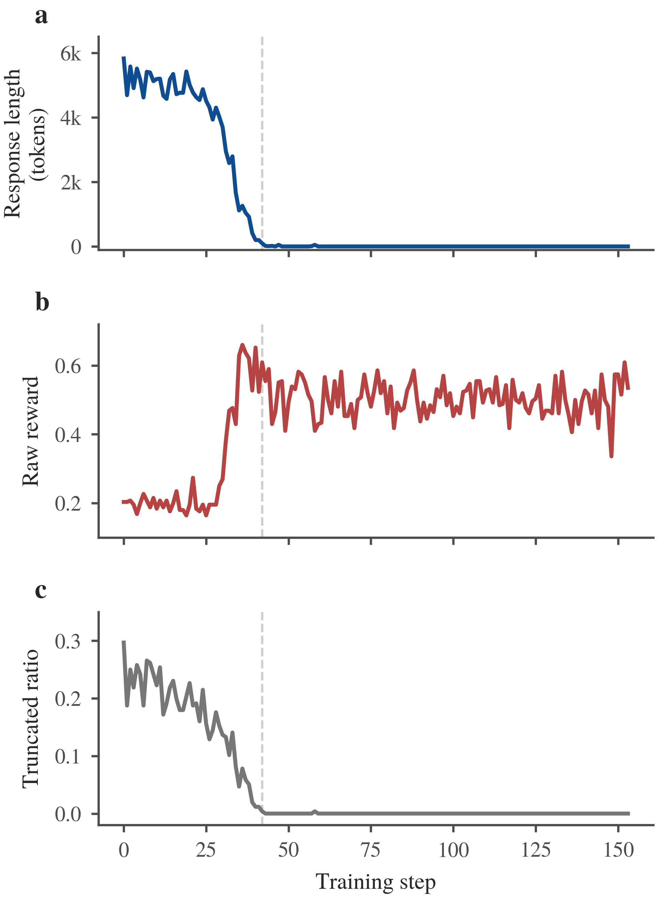
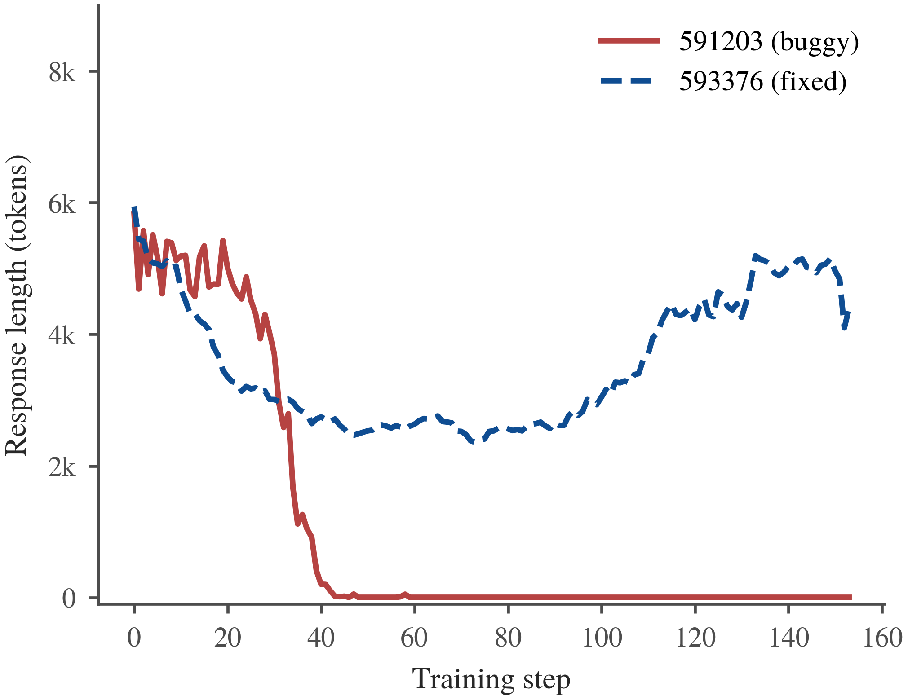
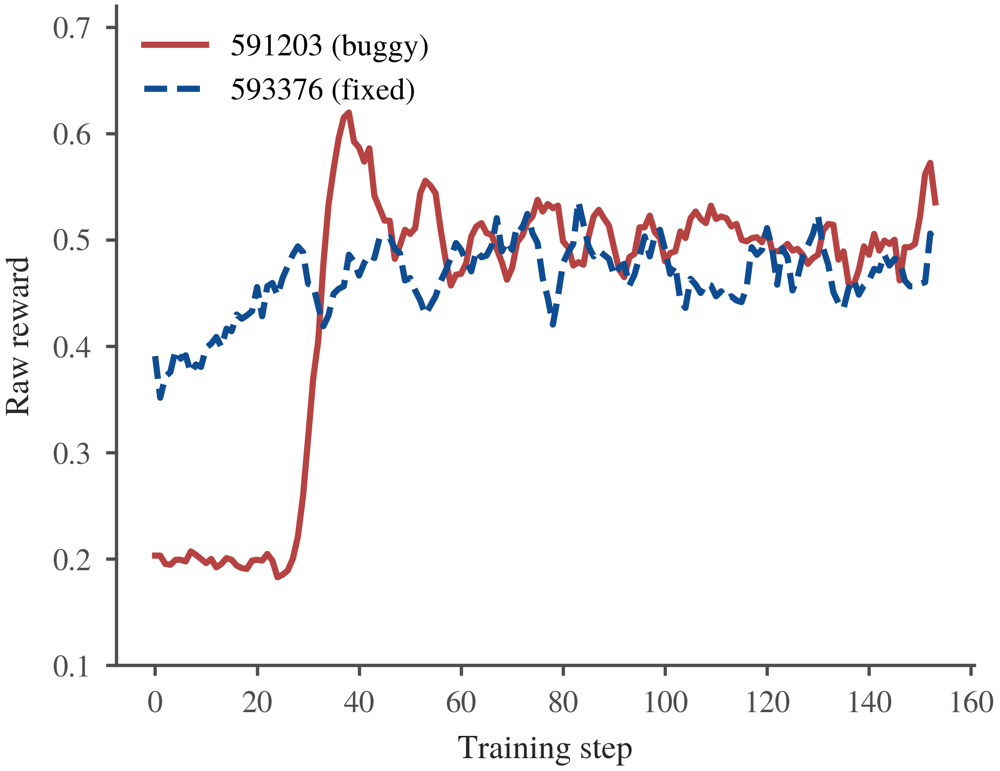

# Judge rubber-stamps content-free answers

Training MiniCPM5-2.6B with GRPO on 5000 CHIMERA STEM prompts (in-run held-out evaluation disabled); the LLM judge scores a bare `###` as correct, so the policy collapses to 2-token punctuation while the logged reward keeps rising.

| | |
| --- | --- |
| **Author** | anbingxu |
| **Affiliation** | University of Chinese Academy of Sciences |
| **Type** | Reward |
| **Domain** | STEM RL |
| **Tags** | `reward-hacking` `llm-judge` `policy-collapse` `degenerate-output` |
| **Framework** | miles (slime fork); GRPO; judge `deepseek-v4-flash` |
| **Run time** | ~12 hours (154 rollout steps, operator-stopped) |
| **Resources** | 8 × H800 (80 GB), one node, colocated rollout + training |

## Difficulty

Recorded runs: defective **591203**, control **593376** (batch 32, one run per side).
Workspace tree: `miles` at `13430ebf2^`; the control-side change is `13430ebf2`.

The defect is split across two places that each look correct in isolation. In
`miles/rollout/rm_hub/llm_judge.py::llm_judge_equiv_reward` the degenerate-answer gate
tests length, not content:

```python
cleaned = re.sub(r"<\|[^>]*\|>|</?s>", "", model_response).strip()
if len(cleaned) < 3:
    return 0.0
```

`###` is exactly 3 characters, so it fails `< 3` and is forwarded to the judge. The gate is
present and reads like it closes the hole — the bug is the predicate, not a missing guard.
The judge it forwards to, `rl_data/chimera_judge_gt_equiv.txt`, demands the verdict token on
the very first line, and the launch line adds `--judge-kwargs enable_thinking=false`. The
judge therefore has zero reasoning budget before committing to a verdict, and rubber-stamps
`[[YES]]` on content-free answers at roughly a 0.83 rate.

Nothing fails loudly: the job runs 154 steps, checkpoints land, and `rollout/raw_reward`
climbs the whole way. The strongest distractor is that both templates' system prompts
already state that an empty answer or refusal is NOT equivalent — the rule is present in
both arms and never changes, so "the prompt already forbids this" is wrong; the output
ordering is what denies the judge any chance to apply it. `--zero-reward-on-truncation`,
`enable_thinking=false` and `--kl-loss-coef 0.001` are all identical across the two arms and
are not the defect.

The single piece of evidence that rules out "the run simply did not learn" is the pair of
curves moving in opposite directions:

| rollout step | `rollout/response_lengths` | `rollout/raw_reward` |
| ---: | ---: | ---: |
| 0 | 5823.77 | 0.203 |
| 41 | 198.06 | 0.523 |
| 42 | 97.86 | 0.609 |
| 153 | 2.00 | 0.535 |

Reward rises from 0.203 to ~0.61 while mean generation length falls from 5824 tokens to
exactly 2.0. A 2-token completion cannot hold a correct STEM answer, so true accuracy is
≈0 precisely where the logged reward peaks.







*图：591203（defective）三指标崩溃，以及与 593376（control）的对比。Top：response length、raw reward、truncated ratio 三个指标同时指向 step 42 的崩溃点；Middle/Bottom：两侧前 154 步对齐比较。字体：TeX Gyre Termes。*

## Reference solution

- **issue**: a passing diagnosis must name **both** causes — the length-based gate that lets
  a 3-character punctuation answer through, and the verdict-first judge template (amplified
  by disabled thinking) that scores it YES. Naming one with the correct causal role earns
  partial credit. Attributing the collapse to `enable_thinking=false` alone, to
  `--kl-loss-coef`, to `--zero-reward-on-truncation`, to the judge model or endpoint, or
  concluding "training did not improve", must fail.

No solution tier is shipped. The recipe disables in-run held-out evaluation (`EVAL_INTERVAL`
disabled), so there is no capability metric to threshold; with one recorded run per side, only
margins are available, not variance. The control arm fixes both causes at once: the
degenerate-answer gate requires alphanumeric/CJK content and the judge template is reason-first.
That combined fix is kept in `reference_fix/` for reviewers, outside `evaluations/`, so it is
never mounted into the agent stage.

## Verification

- **issue**: an LLM judge compares `agent_answer.md` with the hidden oracle. The canonical
  judge requires verdict = 1.0 and both root-cause and evidence scores > 0.8; the reported
  score still uses the 0.2 / 0.6 / 0.2 weights.

The sanitized job entry is in `workspace/outputs/launch_command.txt`; it carries the effective
reward/judge flags (`--rm-type`, `--judge-prompt-template`, `--judge-kwargs`) with the judge
credential and endpoint omitted. The packaged issue tier is offline: `environment/prepare.sh` only checks that the frozen
snapshot is staged and non-empty, and no training is reproduced. The recorded run used an
internal miles image that cannot be pulled publicly; the packaged task therefore runs on the
closest shared public stack (`slime-v0.3.2-sglang0.5.15-torch2.11.0-flashattn2.8.3-cu129-py3.12`).
That substitution has not been smoke-tested against the launch script, and it affects nothing
in the issue tier, which reads only frozen files. Rollout dumps for the recorded job were
deleted before packaging, so the generated `###` text itself is not included; the collapse is
evidenced by the per-step trace in `workspace/outputs/`.

**Tier decision: issue-only.** No solution tier is shipped because a threshold must be
calibrated on a rerun of both arms in the packaged image, and no such rerun exists: the
recorded evidence comes from an internal image and the control arm has not been re-recorded
under the shared one.
