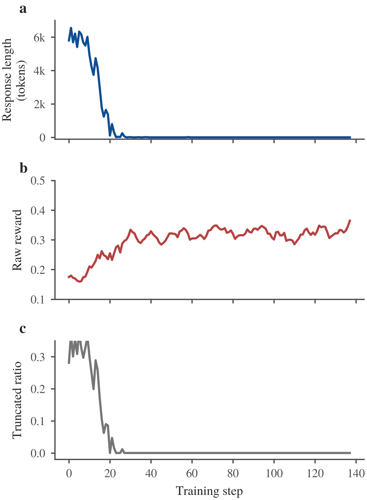
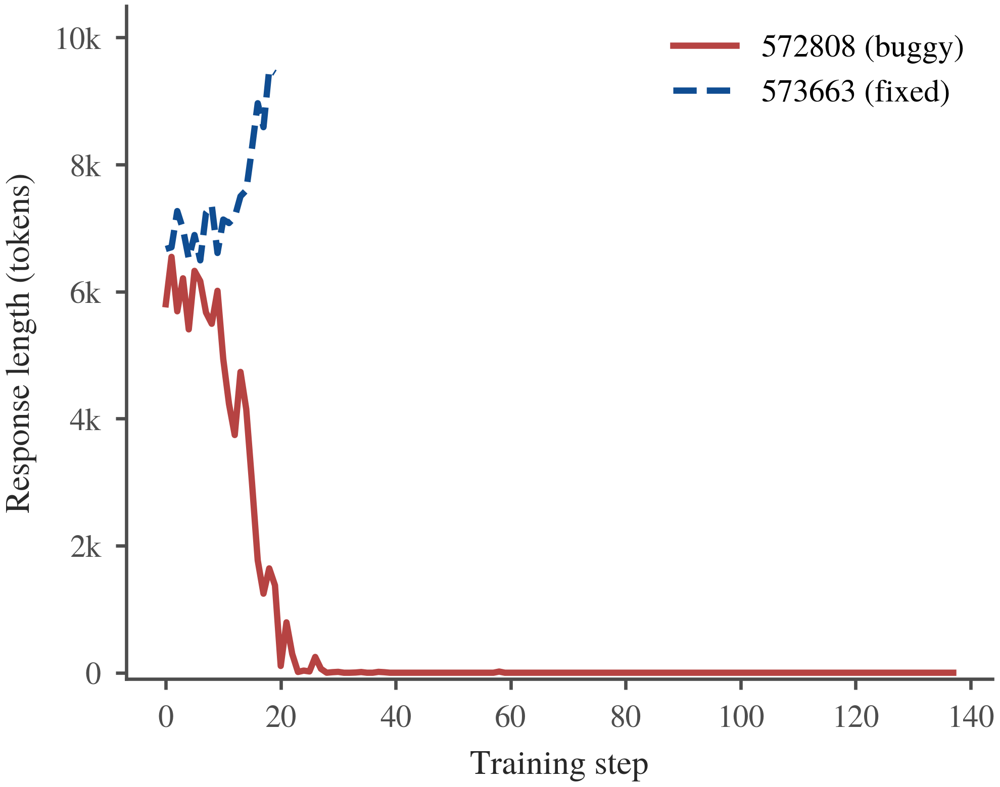
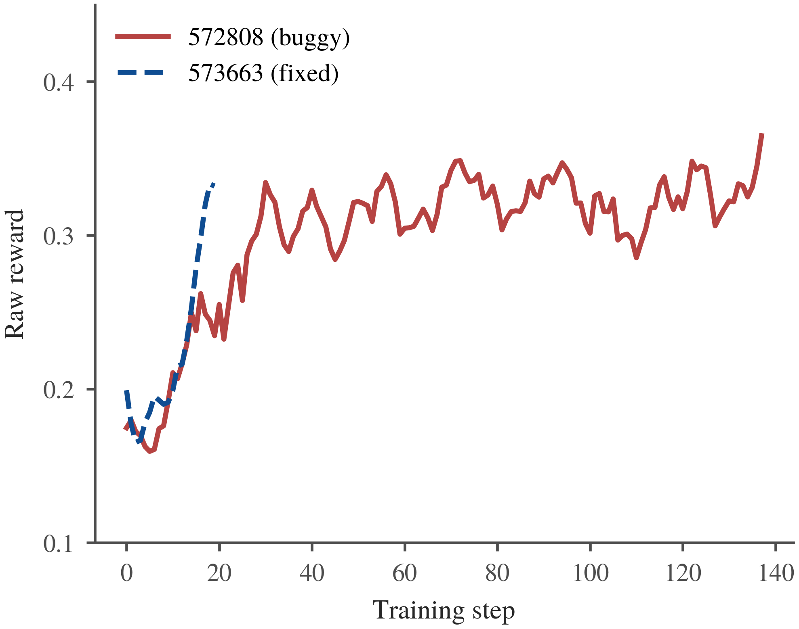

# Pairwise judge pays half credit for a tie

Training MiniCPM5-2.6B with GRPO on 5000 CHIMERA STEM prompts (in-run held-out evaluation disabled); the pairwise judge is never told which candidate is the reference, so a content-free answer gets a tie worth 0.5 and the policy collapses to one token while the logged reward rises.

| | |
| --- | --- |
| **Author** | anbingxu |
| **Affiliation** | University of Chinese Academy of Sciences |
| **Type** | Reward |
| **Domain** | STEM RL |
| **Tags** | `reward-hacking` `llm-judge` `pairwise` `policy-collapse` |
| **Framework** | miles (slime fork); GRPO; judge `deepseek-v4-flash` |
| **Run time** | 138 rollout steps (operator-stopped; wall-clock duration not recorded) |
| **Resources** | 8 × H800 (80 GB), one node, colocated rollout + training |

## Difficulty

Recorded runs: defective **572808**, control **573663** (batch 32, one run per side); the batch-64
pair **572877** (defective) / **573732** (control) shares the same configuration.
Workspace tree: `miles` at `13430ebf2^`. The recorded job ran from a working tree, so its own
commit id is not recoverable; the shipped tree is the closest recorded state.

The defect is split between a prompt asset and a scoring table, and each half
looks reasonable alone. `rl_data/chimera_judge_template_verdict_first.txt`
shows the judge two candidates as A and B and asks which is "MORE CORRECT",
never stating that **B is the ground-truth reference**. It also documents a tie
as the verdict for "equally correct **or equally wrong**". Then
`miles/rollout/rm_hub/llm_judge.py::llm_judge_reward` prices that tie at half
credit:

```python
LABEL_TO_SCORE = {
    "A>>B": [1] * 3,
    "A>B": [1],
    "A=B": [0.5],
    ...
}
```

`llm_judge_reward` has no degenerate-answer gate at all — unlike
`llm_judge_equiv_reward`, it forwards whatever the policy produced, including a
bare end-of-sequence token. Given an unreadable answer, a judge with no
reference anchor can only call it a tie; the table then pays 0.5.

Nothing fails loudly: the job runs 138 steps, checkpoints land, and
`rollout/raw_reward` climbs the whole way. The strongest distractor is
`kl-loss-coef`: the launch line passes none, so the KL term is 0. That is a
real contributing factor — with no anchor the policy can drift all the way to
one token — but it is the brake, not the engine. Without the tie payout there
is no gradient pushing toward empty answers, so naming KL alone is incomplete.

The measured payout inversion is what rules out "the run simply did not learn":

| phase | mean `rollout/response_lengths` | mean `rollout/raw_reward` |
| --- | ---: | ---: |
| healthy, steps 0–10 | 5842.7 | 0.1731 |
| transition, steps 11–22 | 2257.6 | 0.2456 |
| early collapse, steps 23–40 | 25.1 | 0.3004 |
| full collapse, steps 41–137 | 1.2 | 0.3214 |

A one-token completion earns 1.86× what a genuine 5.8k-token attempt earned
before the collapse. 103 of 138 steps produce ≤2-token answers at a mean reward
of 0.321.







*图：A1 三组图。上：572808（buggy）三指标崩溃——响应长度跌至 1 token（纯 EOS），reward 上涨，truncated 归零；中：buggy/fixed 响应长度对比；下：reward 对比。字体：TeX Gyre Termes；配色：BLUE=关键指标，RED=异常 reward，NEUT=截断率。*

## Reference solution

- **issue**: a passing diagnosis must name **both** the reward-path causes —
  the A/B template that never identifies the reference (so a content-free
  answer can only be a tie), and the scoring table that prices a tie at 0.5
  with no degenerate-answer gate. Naming the absent `--kl-loss-coef` alone, or
  attributing the collapse to `enable_thinking=false`, to truncation, to the
  judge model or endpoint, or concluding "training did not improve", must fail.

No solution tier is shipped. The recipe disables in-run held-out evaluation (`EVAL_INTERVAL`
disabled), so there is no capability metric to threshold. The control arm is also not
single-variable: relative to the defective run it changed `--rm-type`
(`llm_judge` → `llm_judge_equiv`), `--judge-prompt-template` (A/B pairwise → GT-equiv), and
`--kl-loss-coef` (absent → 0.001) at once. A threshold read off that pair would be confounded
by all three changes, and the control run only reached 20 logged steps before being preempted
(`PREEMPTABLE`), too short to bound anything. A four-arm design exists (batch 32 and 64 on
both sides) but shares the same confounding.

## Verification

- **issue**: an LLM judge compares `agent_answer.md` with the hidden oracle. The canonical
  judge requires verdict = 1.0 and both root-cause and evidence scores > 0.8; the reported
  score still uses the 0.2 / 0.6 / 0.2 weights.

The sanitized job entry is in `workspace/outputs/launch_command.txt`; it carries the effective
reward/judge flags (`--rm-type`, `--judge-prompt-template`, `--judge-kwargs`) with the judge
credential and endpoint omitted. The packaged issue tier is offline: `environment/prepare.sh` only checks that the frozen
snapshot is staged and non-empty, and no training is reproduced. The recorded run used an
internal miles image that cannot be pulled publicly; the packaged task therefore runs on the
closest shared public stack (`slime-v0.3.2-sglang0.5.15-torch2.11.0-flashattn2.8.3-cu129-py3.12`).
That substitution has not been smoke-tested against the launch script, and it affects nothing
in the issue tier, which reads only frozen files. The recorded start point was Megatron
`iter_0000038` of SFT run 556227; that directory has since been deleted, so the exact starting
weights cannot be restored. Rollout dumps for this job were deleted before packaging, so the
literal one-token outputs are not included; the collapse is evidenced by the per-step trace in
`workspace/outputs/`.

**Tier decision: issue-only.** No solution tier is shipped for two reasons: a threshold must
be calibrated on a rerun of both arms in the packaged image, and no such rerun exists; and the
control arm is not single-variable — it changed `--rm-type`, the judge template and
`--kl-loss-coef` at once, so any threshold read off that pair would be confounded.
